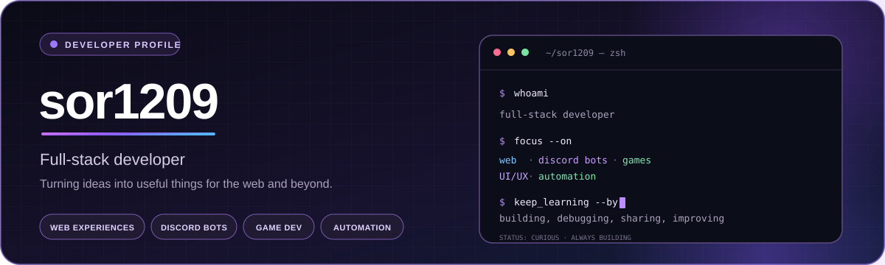
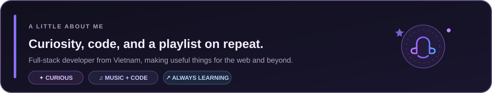
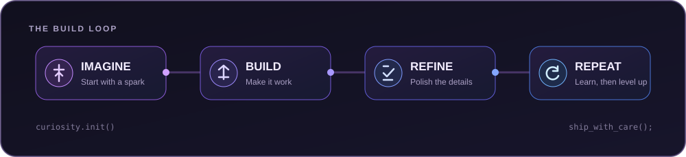
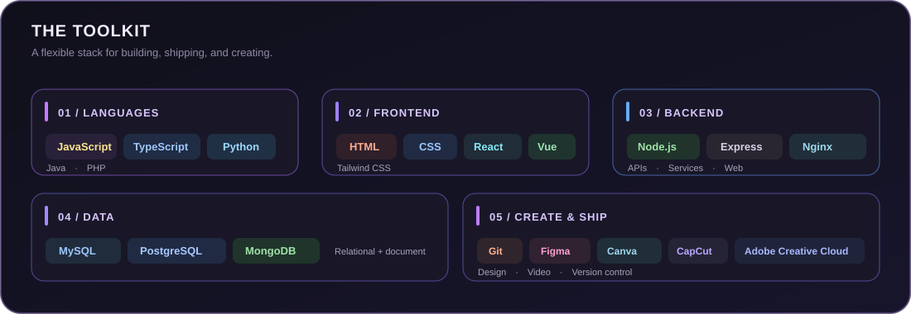

  

  

  
  
  
  

  <a href="#-a-little-about-me">01 / ABOUT</a>　·　
  <a href="#-what-i-build">02 / FOCUS</a>　·　
  <a href="#-my-toolkit">03 / TOOLKIT</a>　·　
  <a href="#-the-stats">04 / ACTIVITY</a>

## 👋 A little about me

  

## 🚀 What I build

  
  
  
  

  

  

## 🧩 My toolkit

  

  

## 📊 The stats

  

  
  
  

  
  

  

  

  

  <b>✨ Let's build something cool together ✨</b>
   
  <a href="https://discord.com/users/882173065163849739">Say hi on Discord</a>
  ·
  <a href="https://github.com/sor1209">Explore my GitHub</a>

