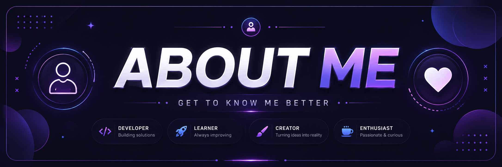
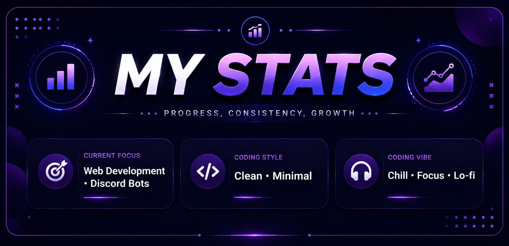
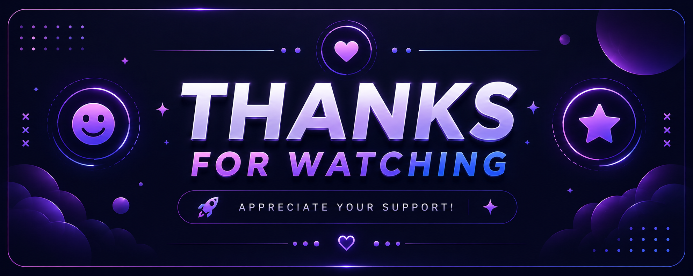

  

  

  
  
  

  

## 👋 A little about me

> 💻 Full-stack developer , turning ideas into useful things for the web and beyond.

🌱 Always learning · 🚀 Web, Discord bots, UI/UX & automation · 🎵 Music on, code on

  

## 🧩 My toolkit

| Category | Stack |
|:--|:--|
| ⌨️ **Languages** |      |
| 🎨 **Frontend** |      |
| ⚙️ **Backend** |    |
| 🗄️ **Databases** |    |
| 🛠️ **Tools & design** |        |

  

## 📊 The stats

  

  
  

  

  

  

  
   
  

